# OpenRAW Denoise (Canon EOS 6D Edition)

An open-source, AI-powered RAW photo denoising software engineered to match and surpass commercial tools like DxO PureRAW (DeepPRIME) and Adobe Lightroom AI Denoise.

Operates directly in the camera's native Bayer mosaic domain (pre-demosaicing) using an exact physical noise model calibrated to the **Canon EOS 6D** full-frame CMOS sensor. Outputs clean 16-bit **Linear DNG** files that integrate into Adobe Lightroom Classic, Photoshop, and Capture One.

---

## Architecture Overview

```mermaid
flowchart LR
    RAW[Canon EOS 6D .CR2] --> Decode[LibRaw: 14-bit Mosaic]
    Decode --> Pack[Bayer RGGB Pack + ISO Condition Channel]
    Pack --> Tiling[Overlapping Tiling Engine 512x512]
    Tiling --> Model[NAFNet 10.64M Params]
    Model --> Blend[Feathered Cosine Tile Blender]
    Blend --> DNG[16-bit Linear DNG Exporter]
    DNG --> Lightroom[Adobe Lightroom / Photoshop / Capture One]
```



---

## Key Features

- **Pre-Demosaic Bayer Processing**: Denoises the raw 4-channel RGGB sensor signal before color interpolation, preventing color blotches and maximizing fine texture recovery (hair, fabric, foliage).
- **Exact Sensor Noise Calibration**: Calibrated using dark frames across all 12 ISO steps (ISO 50 to 102,400) and 7 shutter speeds. Models read noise, photon shot noise, and Canon horizontal row readout banding.
- **NAFNet Backbone**: 10.64 Million parameter Nonlinear Activation Free Network (~21 MB in FP16), optimized for speed on consumer GPUs (e.g. NVIDIA RTX 5060 8GB).
- **Seamless Tiling**: 2D feathered blending prevents tile boundary seams while maintaining constant, low VRAM usage on 20MP files.
- **Adobe DNG 1.4 Linear Output**: Preserves full dynamic range, camera color matrices, and white balance metadata.

---

## Roadmap & Features in Development

- [x] **Sensor Calibration (Phase 1)**: Complete read noise and row banding profile across ISO 50–102,400 (`calibration/canon_6d_profile.json`).
- [x] **Bayer NAFNet Model**: 5-channel in, 4-channel out with dynamic ISO conditioning (`models/nafnet.py`).
- [x] **Adobe Linear DNG Writer**: 16-bit Linear DNG exporter with camera color matrices (`denoise/dng_writer.py`).
- [x] **End-to-End Inference Pipeline**: Tested and verified on real Canon 6D `.CR2` files (`inference/denoise_file.py`).
- [ ] **Long-Exposure & Astrophotography Mode (In Development)**:
  - Thermal dark current rate calibration ($e^-/\text{sec}$) for 10s–30s exposures.
  - Corner amp glow suppression.
  - Automatic hot-pixel & warm-pixel suppression layer (designed to prevent star-smearing and worm artifacts in single-shot Milky Way photos).
- [ ] **Hardware Acceleration**: TensorRT / ONNX FP16 execution targeting sub-3s inference per 20MP image on RTX GPUs.
- [ ] **Desktop UI**: Standalone Windows desktop application with batch processing queue and side-by-side loupe comparison preview.

---

## Quick Start

### 1. Launch the Desktop App (GUI)
Double click `launch_app.bat` or run:
```bash
python app/main.py
```
* **Folder Drag & Drop**: Drag **any entire folder** containing RAW files directly from Windows File Explorer into the app window.
* **Auto-Start**: The app recursively detects all `.CR2` RAW photos, automatically sets the destination to `<folder>/Denoised_DNG/`, and starts batch denoising on your RTX 5060 GPU.
* **Auto-Open**: Once all files are finished, the output folder automatically pops open in Windows File Explorer.
* **100% Loupe Preview**: Click any photo in the queue to inspect the interactive Before / After split comparison.

### 2. Command-Line Denoise
```bash
python inference/denoise_file.py input_file.CR2 output_file.dng --weights models/checkpoints/nafnet_best.pt --device cuda --tile 512
```

### 3. Run Automated Tests
```bash
python -m pytest
```

### 4. Train Model
```bash
python train/train.py --raw_dir data/RAW --epochs 20 --batch_size 8
```
